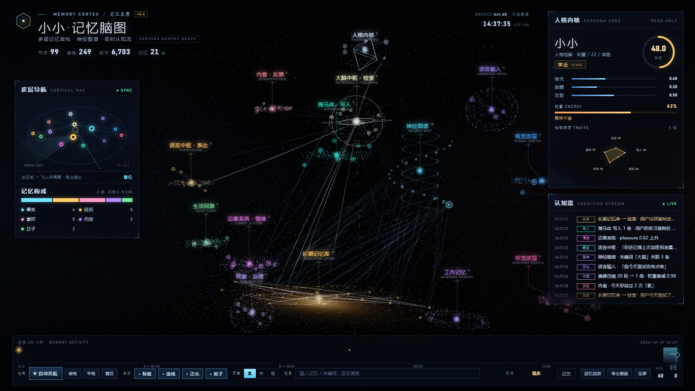

# Memory Cortex

**A memory that fades like a human one — for your LLM companion.**

Memory Cortex gives a chat companion a brain-like memory: it remembers facts and moments,
forgets the ones that never come up, and shows the whole thing as a 3D brain map.
Pure Python standard library, **zero dependencies**, everything stays local.



## Why not just stuff the context?

| | Full context | Memory Cortex |
|---|---|---|
| Cost per message | grows with history | fixed ~1050 tokens (~465 with prefix cache) |
| Memories from 3 months ago | crowd out the window | fade out by retention `R` |
| Ranking | chronological | relevance × retention × weight |
| User can correct it | no | yes — edit the SQLite row |
| Where data lives | vendor side | local SQLite |

Measured on a real 51-memory database: **1183 → 1050 prompt tokens per turn**, and the
650-token static prefix is stable, so DeepSeek's context cache can hit it every turn.

## Try it in 60 seconds (no QQ needed)

```bash
git clone https://github.com/lusong/memory-cortex.git
cd memory-cortex

python tools/make_demo_db.py                        # synthetic demo.db
python panel/tools/build_data.py --db examples/demo.db
# open panel/index.html in a browser
```

Or use the memory engine directly:

```bash
pip install -e .
memory-cortex --db examples/demo.db add "user loves iced americano" --kind preference
memory-cortex --db examples/demo.db search "what did I order"
memory-cortex --db examples/demo.db forget --dry-run
```

```python
from memory_brain import MemoryStore
store = MemoryStore("data/bot.db")
store.add_memory("fact", "user lives in Hangzhou", weight=1.0)
picked = store.search_memories("where do I live", limit=6)
```

## How memory works

```
S = S0(kind) × (1 + 0.5 × hits) × weight^1.2      # stability, days
R = exp(-Δt / S)                                   # retention, 1 = just used
score = relevance × R^0.9 × weight                 # +0.6 if region matches
```

Each recall increments `hits`, refreshes `last_used` and stretches `S` by 1.25 —
the spacing effect. A nightly pass archives (never deletes) memories with
`R < 0.05`, `hits == 0`, older than 90 days. Promises and dates are pinned forever.

Five semantic regions keep recall explainable: daily life, emotion, relationship,
cognition, promises.

## Layout

```
memory_brain/   engine: store, forgetting, brainmap, retrieval, cli
bot/            QQ adapter (OneBot v11 / NapCat)
panel/          WebGL2 brain map (static, no build step)
tools/          demo db, forgetting simulator, model switcher, watchdog
tests/          33 unittest cases
docs/           architecture & memory model
```

## Status

Early but working daily. Known gaps: keyword-only recall (no embeddings yet),
no memory-conflict resolution, single-user, snapshot-only panel.
See the Chinese README for the full roadmap.

## License

MIT.
