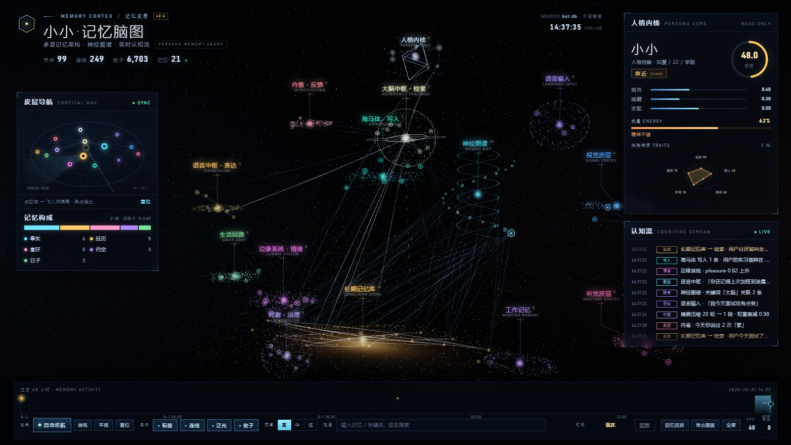

# Memory Cortex · 会遗忘的记忆脑图

**Give your LLM companion a memory that fades like a human one.**

给聊天机器人一个像人脑一样的记忆：会记住、会淡忘、能可视化。
关键词召回 × 艾宾浩斯遗忘曲线 × 语义分区，**纯 Python 标准库，零依赖，数据全在本地**。

<table>
<tr>
<td width="50%">

**它会记住**
- 每轮对话后自动抽取事实 / 经历 / 喜好 / 约定
- 去重合并、按类型给不同的稳定度
- 被想起时强化（间隔重复）

</td>
<td width="50%">

**它会忘记**
- `R = exp(-Δt / S)`，90 天没碰且 R<0.05 才归档
- 约定和日子永不归档
- 归档不删除，仍可查、可恢复

</td>
</tr>
</table>



---

## 为什么不是"把历史全塞进上下文"

| | 全量上下文 | Memory Cortex |
|---|---|---|
| 每条消息的开销 | 随历史线性增长 | 固定约 1050 tok（前缀缓存后 ≈465） |
| 三个月前的记忆 | 挤占上下文 | 按 R 自然衰减，该忘就忘 |
| 记忆的排序 | 按时间 | 相关度 × 保持度 × 权重 |
| 用户能否纠正 | 不能 | `#记住` / `#忘掉`，直接改库 |
| 数据在哪 | 服务商 | 本机 SQLite |

在真实对话上实测（51 条记忆）：**每轮 prompt 1183 → 1050 tok**，
其中 650 tok 是每轮完全一致的静态前缀，可被 DeepSeek 上下文缓存命中。

## 召回评测（30 条查询，合成集）

```
指标            基线(无遗忘)   Memory Cortex
Recall@1          0.633          0.667
Recall@3          0.667          0.733
MRR@5             0.658          0.700
平均注入 token     21.6           16.1   (-25%)
```

9 条查询与目标记忆**没有任何字面重合**（还没做向量召回），两边都召不回；
只看关键词能命中的 21 条时，Recall@3 是 0.952 → 1.000。
复现：`python tools/eval_recall.py`

---

## 60 秒体验（不需要 QQ）

```bash
git clone https://github.com/lusong/memory-cortex.git
cd memory-cortex

python tools/make_demo_db.py          # 生成 examples/demo.db（21 条合成记忆）
python panel/tools/build_data.py --db examples/demo.db
# 直接用浏览器打开 panel/index.html
```

想看**实时**面板（跟着库里变化动）：

```bash
python tools/panel_server.py          # http://127.0.0.1:8090
# 浏览器打开 http://127.0.0.1:8090/?live=1
```

`?live=1` 时每 3 秒拉一次 `/api/state`，人格卡/记忆数/构成条跟着变；
记忆条数变化会整页刷新一次（重建 3D 场景）。必须走 http，`file://` 下 fetch 会被拦。

或者用命令行玩这个记忆库：

```bash
python -m memory_brain.cli --db examples/demo.db add "用户喜欢冰美式" --kind preference
python -m memory_brain.cli --db examples/demo.db search "今天点了什么"
python -m memory_brain.cli --db examples/demo.db list
python -m memory_brain.cli --db examples/demo.db forget --dry-run
python -m memory_brain.cli --db examples/demo.db stats
```

装成库：

```bash
pip install -e .
python -c "from memory_brain import MemoryStore; s = MemoryStore('t.db'); s.add_memory('fact','用户住在杭州')"
memory-cortex --db t.db search "住哪"
```

---

## 四层结构

```
memory_brain/      ★ 记忆引擎（可单独 pip 安装）
  store.py          SQLite：记忆 / 消息 / 档案 / 状态 / 日记
  forgetting.py     遗忘曲线：S、R、复习强化、归档判定
  brainmap.py       五个语义分区：生活 / 情绪 / 关系 / 认知 / 约定
  retrieval.py      召回：相关度 × R × 权重 + token 预算 + 分区加权
  cli.py            命令行

bot/               QQ 适配层（OneBot v11 / NapCat）
panel/             记忆脑图（WebGL2，纯静态，无构建步骤）
tools/             演示库、遗忘模拟、换模型、扫码页、守护进程
tests/             33 个用例，`python -m unittest discover -s tests`
docs/              架构说明、记忆模型说明
```

---

## 记忆怎么工作

```
新记忆 → stability = S0(kind) × (1 + 0.5×hits) × weight^1.2
                 region      = 关键词 + 类型先验 落在五个分区之一

每次召回 → score = 相关度 × R^0.9 × weight (+0.6 若命中分区)
                 R = exp(-Δt / stability)
           取前 3 条全文、之后截断，总预算 320 tok
           选中的记忆：hits+1、last_used=now、S×1.25（复习变平）

每天一次 → R<0.05 且 hits=0 且库龄>90 天 → archived=1（不进 prompt，不删）
```

| 类型 | S0（天） | 说明 |
|---|---|---|
| 约定 promise | 120 | 永不归档 |
| 日子 date | 400 | 永不归档 |
| 喜好 preference | 45 | |
| 事实 fact | 30 | |
| 经历 event | 10 | 最快淡忘 |

细节与调参见 [docs/memory-model.md](docs/memory-model.md)。

---

## 向量召回（可选，默认关闭）

关键词召回对「换说法」无能为例。内置了可插拔的向量通道：

```bash
# 零依赖，用字符哈希向量跑通链路（只适合演示/测试，语义能力有限）
python tools/eval_recall.py --vector hash

# 本地 Ollama（推荐；需要你自己装，Python 侧仍零依赖）
ollama pull nomic-embed-text
# config.json: "vector_enabled": true, "vector_provider": "ollama",
#              "vector_model": "nomic-embed-text", "vector_base_url": "http://127.0.0.1:11434"

# 或任何 OpenAI 兼容的 /embeddings（会出网）
# "vector_provider": "openai", "vector_api_key_env": "OPENAI_API_KEY"
```

两路分数用 **RRF（Reciprocal Rank Fusion）** 融合：只看排名，不混用量纲。
`vector_weight` 控制向量通道的权重（0 = 纯关键词，1 = 纯向量）。

**现状说明（实测，不吹）**：`hash` provider 只捕捉字面相近，
在 30 条评测集上 Recall@3 没有提升（0.733 → 0.733），
说明真正解决「换说法」需要**语义 embedding 模型**，不是字面哈希。
装上 Ollama 后跑同一份评测才能看到真实增益。

## 接入 QQ（可选）

1. 装 [NapCat](https://github.com/NapNeko/NapCatQQ)，用**小号**登录；
2. `tools/set_llm.py --base https://api.deepseek.com --model deepseek-chat --key sk-xxx --test`
3. 复制 `config.example.json` → `config.json`，填上 key；
4. 启动 NapCat → 扫码 → `start_bot.bat`；
5. 用主号给小号发 `#绑定`，之后只跟这个号聊。

她在 QQ 里能用的命令：

| 命令 | 作用 |
|---|---|
| `#状态` | 心情 / 精力 / 亲密度 |
| `#记忆` | 记住的东西（带编号） |
| `#记住 <一句话>` | 手动让她记下来（权重 1.3，不会被轻易忘） |
| `#忘掉 <编号>` | 别再提这条（归档，可恢复） |
| `#恢复 <编号>` | 把忘掉 / 更正的找回来 |
| `#纠正 <编号> <新说法>` | 用新记忆覆盖旧记忆（旧的标记 superseded，不再召回） |
| `#遗忘` | 总数、活跃、归档、已更正、平均保持度，以及最可能被忘的 5 条 |
| `#日记` | 昨天她写的日记 |

---

## 隐私

- 聊天、记忆、日记、画像全部在本地 `data/bot.db`；
- 只有发给模型的上下文会出网；换成本地模型（Ollama / llama.cpp）就完全不出网；
- 仓库里不含任何真实聊天数据，`data/`、`config.json`、`logs/` 都已在 `.gitignore`。
- 详见 [SECURITY.md](SECURITY.md)。

---

## 已知限制

1. **召回是关键词匹配**：换个说法可能召不回（"我让你怎么叫我来着" ↛ "希望被称呼为阿明"）。
   现在有兜底召回兜着（`fallback_top: 2`），会塞 1~2 条高权重记忆，但可能答得笼统。
2. 面板默认是**快照**；想看实时用 `tools/panel_server.py` + `?live=1`（3 秒轮询，不是推送）。
3. 分区是规则式关键词匹配，会误判；因此召回时只加分、不淘汰。
4. 单用户单库。多用户（`user_id`）未实现，但 schema 已预留扩展空间。
5. token 数是按字符估算（中文 ≈1.6 字/token），不是精确 tokenizer。

## Roadmap

- [x] 兜底召回（没命中时带 1~2 条高权重记忆）
- [x] `#记住` / `#忘掉` / `#恢复` / `#纠正` 命令
- [x] 记忆冲突覆盖（`#纠正` + 召回时去重）
- [x] 记忆溯源（`source` 字段记录来自哪条消息）
- [x] 参数可配（`memory_brain.configure()`，`config.json` 的 `memory` 段）
- [x] 召回评测集 + `eval_recall.py`（Recall@3 / MRR）
- [x] 实时面板（本机 HTTP 轮询，`tools/panel_server.py`）
- [x] 向量召回骨架（RRF 融合 + 可插拔 provider，默认关闭；真实增益待接语义模型验证）
- [ ] 多用户（`user_id`）

## 许可

MIT。人格卡 `persona.example.json` 仅为示例，改成你自己的。
